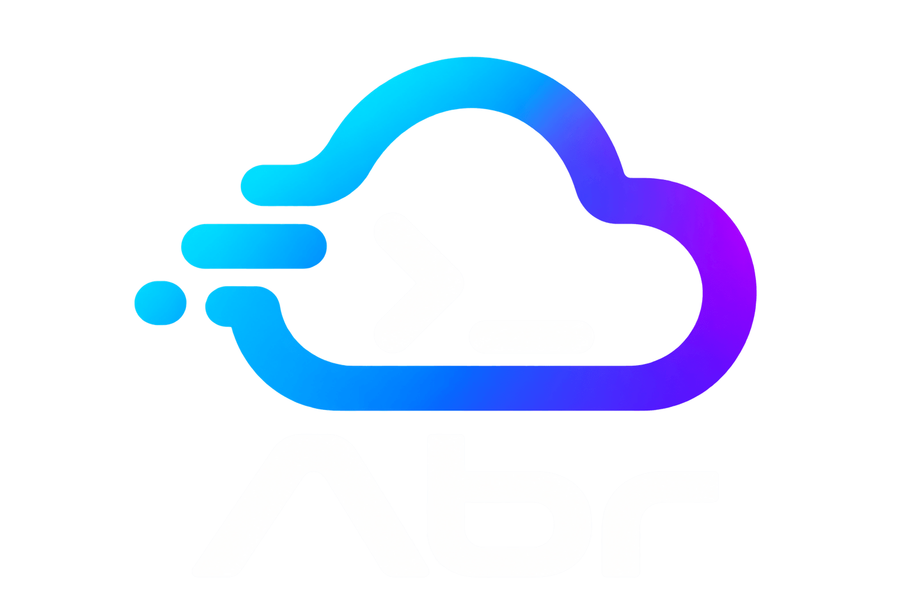

# Abr

Deploy Laravel and Nuxt apps on a fresh **Ubuntu 26.04 LTS AMD64** VPS.
Abr manages Caddy HTTPS, shared runtimes, app users, services, databases and ports.
Use the guided terminal menu or scriptable CLI. Version **1.0.0**.

## Install and set up

On your VPS:

```sh
curl -fsSL https://raw.githubusercontent.com/FaridAghili/abr/main/scripts/install.sh | bash
```

The installer verifies the release checksum and installs `/usr/local/bin/abr`.
You can also download the binary or template bundle from [Releases](https://github.com/FaridAghili/abr/releases).

Before setup, point your app's DNS at the VPS and allow your SSH port,
TCP 80/443 and UDP 443 through the provider firewall.
**Test SSH key login in a second terminal and keep it open: setup disables password login.**
Update Ubuntu and reboot first if `/var/run/reboot-required` exists.

```sh
abr setup --hostname my-vps --dry-run
sudo abr setup --hostname my-vps
sudo abr
```

Setup installs PHP 8.5, Node 24, Caddy, RoadRunner, Composer, MySQL, Redis and
image tools. It also configures UFW, Fail2ban, security updates, root's Zsh and
swap when the server has none, and removes snapd when nothing uses it.
Use `--admin-user USER` if your SSH account differs from the sudo user.

## Deploy your first app

In `sudo abr`, choose **Server & credentials → GitHub key** and add the public
key to your GitHub account. Then choose **Add application → Clone application**. Abr asks for a
name and domain, detects the framework, and guides you through settings,
`.env` and deployment. Projects live at `/srv/apps/NAME`.

Or use the CLI:

```sh
sudo abr git setup
# Add the printed public key to GitHub before cloning.
sudo abr clone git@github.com:OWNER/PROJECT.git api
sudo abr register --name api --type laravel --domain api.example.com
sudo abr env api
sudoedit /srv/apps/api/.env
sudo abr deploy api --no-pull
```

Use `--type nuxt` for Nuxt. Laravel defaults to PHP-FPM; Octane, queues and
scheduled jobs are optional. Set app secrets before deploying.
Deployments may cause downtime and run Laravel migrations; failed changes are
not automatically rolled back.

## Everyday commands

| Task | Command |
| --- | --- |
| Open the menu | `sudo abr` |
| Deploy latest code | `sudo abr deploy api` |
| Check services | `sudo abr status api` |
| Read logs | `sudo abr logs api` |
| Follow logs | `sudo abr logs api --follow` |
| Check configuration and ports | `sudo abr doctor` |
| Check disk usage | `sudo abr disk` |
| See CPU and memory per app | `sudo abr stats` (live in **Resource monitor**) |
| Update server tools | `sudo abr update` |
| Back up apps | `sudo abr backup --all` |
| Schedule backups, keep newest 7 | `sudo abr edit api --backup-schedule daily --backup-keep 7` |
| Check backup schedules | `sudo abr backup status` |
| Restore app backups or a server | `sudo abr restore /var/backups/abr/restore --yes` |
| Remove an app, keeping its data | `sudo abr remove api` |

Backups use the saved remote destination when configured; otherwise they stay
local. Schedules are `6h` (every 1-23 hours), `daily` or `weekly`; an hourly
timer backs up each app when due. Older archives beyond `--backup-keep` are
deleted locally and on the backup server, which needs only SSH access and a
private directory. Archives contain secrets and are **not encrypted**. Keep a protected
off-server copy and test restores. Restoring a directory uses the newest backup
of each app in it. On a set-up server, app backups are added as new apps; on a
fresh server, the saved server settings are provisioned first. Permanent
removal requires `--purge --yes`.

In menus, type to filter, Enter to continue, Shift+Tab to revisit a field,
and Esc to go back. Advanced settings are optional.

## More help

- `abr help` lists commands; `abr COMMAND --help` lists flags.
- [Example config](config.example.toml) and [editable templates](templates/).
