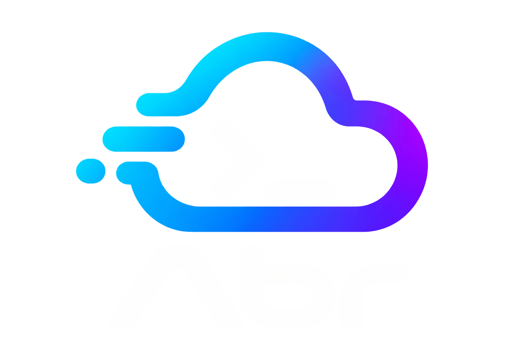

# Abr

Deploy Laravel and Nuxt apps on a fresh **Ubuntu 26.04 LTS AMD64** VPS.
Abr manages Caddy HTTPS, shared runtimes, app users, services, databases and ports.
Use the guided terminal menu or scriptable CLI. Version **1.0.0**.

## Install and set up

On your VPS:

```sh
curl -fsSL https://raw.githubusercontent.com/FaridAghili/abr/main/scripts/install.sh | bash
```

The installer verifies the release checksum and installs `/usr/local/bin/abr`.
You can also download the binary or template bundle from [Releases](https://github.com/FaridAghili/abr/releases).

Before setup, point your app's DNS at the VPS and allow your SSH port,
TCP 80/443 and UDP 443 through the provider firewall.
**Test SSH key login in a second terminal and keep it open: setup disables password login.**
Update Ubuntu and reboot first if `/var/run/reboot-required` exists.

```sh
abr setup --hostname my-vps --dry-run
sudo abr setup --hostname my-vps
sudo abr
```

Setup installs PHP 8.5 and MySQL 8.4 LTS from Ubuntu, the latest stable Caddy,
Node 26 LTS from NodeSource, Redis from packages.redis.io, RoadRunner, Composer and
image tools. It also configures UFW, Fail2ban, security updates, Zsh with Oh My
Zsh for root and the SSH administrator, swap when the server has none, and
removes snapd when nothing uses it.
Use `--admin-user USER` if your SSH account differs from the sudo user.

## Deploy your first app

In `sudo abr`, choose **Server & credentials → GitHub key** and add the public
key to your GitHub account. Then choose **Add application → Clone application**. Abr asks for a
name and domain, detects the framework, and guides you through settings,
`.env` and deployment. Projects live at `/srv/apps/NAME`.

Or use the CLI:

```sh
sudo abr git setup
# Add the printed public key to GitHub before cloning.
sudo abr clone git@github.com:OWNER/PROJECT.git api
sudo abr register --name api --type laravel --domain api.example.com
sudo abr env api
sudoedit /srv/apps/api/.env
sudo abr deploy api --no-pull
```

Use `--type nuxt` for Nuxt. Laravel defaults to PHP-FPM with up to 8 on-demand
workers; `--web-workers N` sets PHP-FPM's limit or the Octane process count.
Octane, queues and scheduled jobs are optional. Set app secrets before deploying.

For WebSockets, a Laravel app can run Laravel Reverb at its own domain:
`--reverb-domain ws.example.com` when registering, `abr edit api --reverb-domain ws.example.com`
later, or **Reverb · WebSockets** in the menu. Point that domain's DNS at the VPS.
Reverb runs as the app's own service on a reserved local port. Caddy serves its
WebSocket path `/app`, its API `/apps` and its `/up` health check at that domain
and answers 404 for everything else. `abr env` and every deployment set
`BROADCAST_CONNECTION=reverb`, `REVERB_HOST` (the Reverb domain), `REVERB_PORT=443`
and `REVERB_SCHEME=https` in `.env`, and generate `REVERB_APP_ID`, `REVERB_APP_KEY`
and `REVERB_APP_SECRET` only when they are empty. The app sends broadcasts to
Reverb through that public domain. A separate frontend, such as a Nuxt app,
connects with Laravel Echo to `wss://ws.example.com` using the public app key
`abr env` prints; list its origin in `allowed_origins` in `config/reverb.php`.
Open connections survive other apps' deployments; deploying the app itself
restarts Reverb, and clients reconnect. Each Reverb server holds about 1,000
connections at once, the limit of PHP's built-in event loop. `--reverb-domain ''`
stops Reverb and leaves its `.env` values; change `BROADCAST_CONNECTION` yourself.
Each Laravel app gets its own pair of Redis databases, from 10 upwards: `abr env`
and every deployment set `REDIS_DB` (sessions, queues and locks),
`REDIS_CACHE_DB` and `REDIS_PREFIX` in its `.env`, so `cache:clear` empties only
that app's cache. Databases 0–9 stay unassigned for tools that use the defaults.
Redis may use 20% of the server's RAM (at least 256 MB) and never evicts keys;
MySQL's InnoDB buffer pool gets 25% (at least 256 MB). Both are set by `abr setup`.
Redis requires authentication: each Laravel app connects as its own Redis user
(`REDIS_USERNAME`, `REDIS_PASSWORD` in `.env`, written by `abr env` and every
deployment) that can only use keys with its prefix, so apps cannot read each
other's sessions, cache or queues. `config/database.php` must pass
`REDIS_USERNAME` to the Redis client, as Laravel's default configuration does.
**Server & credentials → Redis password** in the menu, or `abr database --redis-admin --show`,
shows the TablePlus connection (user blank, password shown) over SSH. The
server password is in `/var/lib/abr/redis-admin.json`; for `redis-cli`, run
`export REDISCLI_AUTH=$(sudo sed -n 's/.*"password": *"\([a-f0-9]*\)".*/\1/p' /var/lib/abr/redis-admin.json)`.
Removing an app keeps its Redis databases reserved; `--purge` empties them.
While an app is stopped, during a deployment or after `abr disable`, its domains
answer 503 with a maintenance page and keep their certificates. Nuxt apps fetch
code and install Node packages before stopping; Laravel apps stop first, so a
build never serves half-updated PHP. Deployments run Laravel migrations; failed
changes are not automatically rolled back, and the maintenance page stays up
until the next successful deployment. A connection to GitHub that stalls is
ended after about a minute, and a failed fetch is retried twice before the
deployment gives up; the app keeps serving meanwhile. Laravel builds the frontend before Composer by
default (`--build-order composer-first` reverses it); while `vendor` is missing,
Composer packages are installed without scripts before the frontend build.
`npm ci` is skipped while `package.json`, `package-lock.json`, `.npmrc` and Node
are unchanged since the last successful install; the package's own install
scripts and the build still run. A deployment shows one line per main step with
its time; every command, its output and all step times are in the deployment
log, whose path is shown when a deployment fails; `abr logs api --type history`
lists recent deployments with their result, commit and duration. The newest 50
deployments' logs and records are kept per app.
Health checks for an app's own domains are sent to this server.

## Everyday commands

| Task | Command |
| --- | --- |
| Open the menu | `sudo abr` |
| Deploy latest code | `sudo abr deploy api` |
| Check services | `sudo abr status api` |
| Read logs | `sudo abr logs api` |
| Follow logs | `sudo abr logs api --follow` |
| Check configuration and ports | `sudo abr doctor` |
| Check disk usage | `sudo abr disk` |
| See CPU and memory per app | `sudo abr stats` (live in **Resource monitor**) |
| Update server tools | `sudo abr update` |
| Back up apps | `sudo abr backup --all` |
| Back up here, not to the backup server | `sudo abr backup api --local` |
| Schedule backups, keep newest 7 | `sudo abr backup schedule api portal --schedule daily --keep 7` |
| Check backup schedules | `sudo abr backup status` |
| Restore app backups or a server | `sudo abr restore /var/backups/abr/restore --yes` |
| Restore an app under a new name | `sudo abr restore /var/backups/abr/api-20261010020000.tar.gz --name api-old --yes` |
| Remove an app, keeping its data | `sudo abr remove api` |
| Group related apps in deploy order | `sudo abr group create site api frontend` |
| Deploy a group, stopping at a failure | `sudo abr deploy --group site` (`--no-pull` redeploys the current code) |

Backups use the saved remote destination when configured; otherwise they stay
local in `/var/backups/abr/apps`. `--local` (or **This server** in the menu)
keeps one run here even when a backup server is configured. **Backup
schedules** in the menu sets one schedule for a group of apps at a time, such
as weekly for most sites and every 4h for busy shops. After a verified transfer no archive stays on the production server: an
archive kept by a failed transfer is uploaded and removed on the next
successful run. Schedules are `6h` (every 1-23 hours), `daily` or `weekly`; an hourly
timer backs up each app when due. Older archives beyond `--keep` are deleted
where the backups are kept: on the backup server, which needs only SSH access
and a private directory, or on this server without one. Archives contain secrets and are **not encrypted**. Keep a protected
off-server copy and test restores. Restoring a directory uses the newest backup
of each app in it. On a set-up server, app backups are added as new apps; on a
fresh server, the saved server settings are provisioned first. Backups carry the
backup destination, its SSH key and trusted host key, and each app's last backup
time, so a fresh server keeps backing up on schedule to the same backup server.
Apps are restored, built and started one at a time, Laravel apps first, so a
frontend build that calls their API finds it running. If that build calls the
API by its public domain before DNS points here, add the domain to this
server's `/etc/hosts` during the restore. A failed app is stopped while the
others keep running, and the restore ends with each failure's retry command,
such as `abr deploy NAME --no-pull`. When an app with
the same name already exists, `--name` restores one app backup under a new
name: its project, user, MySQL database and account, services and ports follow
the new name, `DB_DATABASE`/`DB_USERNAME` in its `.env` are updated, and its
domains are kept. Permanent
removal requires `--purge --yes`.

**Groups** in the menu name related apps, such as an API and the frontends
that call it, and deploy them one at a time in the order you set, pulling the
latest commits or redeploying the current code. If one app fails, the rest are
skipped and listed, and a summary shows each app's result. Groups can also
restart or check all of their apps. Deleting a group or removing an app from it
keeps the app; removing an app also takes it out of its groups.

In menus, type to filter, Enter to continue, Shift+Tab to revisit a field,
and Esc to go back. Advanced settings are optional.

## More help

- `abr help` lists commands; `abr COMMAND --help` lists flags.
- [Example config](config.example.toml) and the bundled [templates](templates/),
  which abr installs and refreshes from its executable on every host command.
